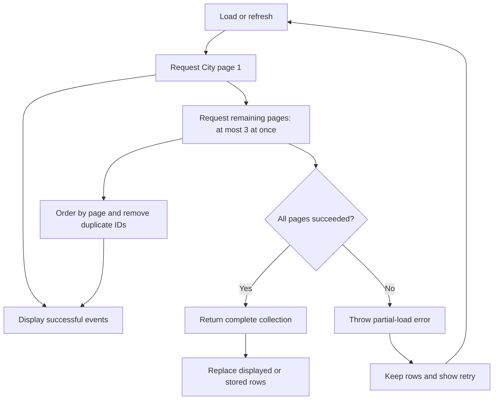

# City Events behavior

Scope: City Events, shared event decoding and display, and the concrete defects in the review of `feature/city-events-redesign`. The fixes preserve the stable City tab root and Festival's adaptive navigation.

## Loading and recovery

The City index uses pages of 30 events. It displays the first page as soon as it arrives, then loads at most three later pages at once. Results use page order and keep the first occurrence of each event ID. A failed later page returns a partial-load error. It does not return a successful collection that could replace all repository rows with incomplete data.

The City controller keeps successful pages and existing rows while it shows a retry action. Retry and pull-to-refresh start a new load. A complete response replaces the displayed collection. A calendar-day change, or activation of the owning scene after midnight, refreshes data and date sections. The Festival `withPages: true` request still uses its single `content` endpoint.

## Search, filters, and dates

Selecting a search result stores the selected event, dismisses search, and opens the detail after dismissal ends. Selection during a dismissal also waits. The query remains available when the person returns to the list. Search uses the same text normalizer for event fields and query terms.

Each snapshot updates retained chips and visible section-header counts. A chip exposes its selected state to accessibility. Events without a start date, and events that do not overlap today or a future day, do not suppress the empty state. An event that ends exactly at midnight does not enter the following day. Filters and date sections accept a calendar and clock for tests.

Structured `isOnline` data takes precedence over a conflicting `offline` string. Explicit hybrid attendance remains hybrid. The Free control is available only when the loaded data includes structured free/paid status. Text such as a teaser is not sufficient price data.

List and detail use one locale-aware date and address formatter. It does not append the city when the address already ends with that city. An explicit editorial subtitle remains visible; a teaser that repeats the description opening is hidden. Festival's legacy stream detail opts into its venue, date, and ticket subtitle and supplies a website action.

## Text size and safe areas

The Events collection view stays inside the current horizontal safe area. Quick filters and spotlight cards use content-driven heights. Standard text sizes keep horizontal scrolling. Accessibility text sizes use full-width vertical rows; spotlight cards hide the image and let all text wrap. Card width follows the current layout environment. Weighted labels use the native preferred font once, including cells created after the text size changes.

Shared event detail uses platform-appropriate background colours on tvOS. The iOS colours stay the same. Inclusive date checks compare reference-date intervals, preserving the same boundaries while avoiding missing weak operator symbols on pre-release iOS 27.2 runtimes.

## Other review corrections

- Optional coordinates accept numeric strings and ignore invalid values. An unknown optional schedule mode does not reject an event. Required identifiers and names remain strict.
- Event tests cover encoding and record mapping. Existing record columns retain lifecycle timestamps; no database schema change is required.
- Localized text uses complete sentences and English keys. URLs stay outside translation keys. Ticket and fuel amounts use EUR currency formatting.
- Rubbish street migration retains the saved reminder minute and applies the existing default time when a value is absent.
- Festival saved-schedule content uses separate leading and trailing safe-area guides.
- App lockfiles retain the baseline dependency versions, except BulletinBoard `6.2.0`, which both projects already require. This removes the unrelated version increases from the review and corrects the invalid `6.1.1` pins.
- Git no longer tracks the generated fastlane report. The local report is preserved and ignored.

## Branch decisions retained

The City tab root is intentional. `RESIZABILITY.md` describes its state-retention behavior and earlier checks. Festival's app, widget, and embedded watch app share one build number to satisfy bundle validation. Availability cleanup removes checks below each target's deployment floor; checks above that floor remain. These decisions are separate from the Events defect fixes. The earlier documents now distinguish historical checks from current behavior.

## Validation

Checked on 6 October 2026 with Xcode 27.1 beta and an iPhone 18 Pro simulator running iOS 27.2. Both apps build. The focused Swift tests use frozen package resolution (`-disableAutomaticPackageResolution -onlyUsePackageVersionsFromResolvedFile`).

| Check | Result |
| --- | --- |
| Events decoding, presentation, record mapping, service endpoints, pagination, partial failure, and cancellation | 30 tests pass. |
| City filter logic, chip/header state, empty state, retry, midnight reload, dismissal sequencing, and migration reminders | 13 tests pass. |
| Festival event layout, changing asymmetric safe areas, and ticket prices | 8 tests pass. |
| Localization checker fixtures | 4 tests pass. |
| Compiler extraction and catalog ownership for the built app and package targets | Pass. |
| SwiftLint for 44 changed or new Swift files | No errors. Existing style and size warnings remain. |
| Source whitespace check | Pass. |

The City device check confirms that Today shows a selected chip and correct counts. An active `Stadtarchiv` search shows one result with count 1. One tap opens the correct detail; one Back tap retains the query and result. Date and venue agree between list and detail. The intro appears once, the website action uses `Open Website`, Free is absent without structured price data, and Online returns online events.

Local evidence: [active search](/Users/lennart/.codex/visualizations/2026/10/05/01a10de0-1afa-7843-bacf-770f6a56b8fd/events-review-active-search.png), [detail](/Users/lennart/.codex/visualizations/2026/10/05/01a10de0-1afa-7843-bacf-770f6a56b8fd/events-review-detail.png), and [return to results](/Users/lennart/.codex/visualizations/2026/10/05/01a10de0-1afa-7843-bacf-770f6a56b8fd/events-review-back.png). Matching hierarchy files are stored beside the images.

The Festival Favorites empty state also passes the portrait and landscape check. In landscape, its content starts at x = 62 and has width 750 within an 874-point screen, so it clears both horizontal safe areas. No favorites existed; populated rows were not exercised. The asymmetric-inset unit test checks the content stack independently. [Landscape evidence](/Users/lennart/.codex/visualizations/2026/10/05/01a10de0-1afa-7843-bacf-770f6a56b8fd/events-review-festival-saved-landscape.png).

A separate course-description spacing issue found during the device check is recorded in `../PAPERCUTS.md`. The description publisher and text-view assignment are unchanged by these fixes. The full test suite, older runtimes, and release workflows were not run for this review fix.
