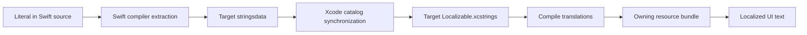

# Localization

Use English natural language keys for new app text. Use a literal at the call site so the Swift compiler can extract it. UIKit and string-valued models use `String(localized: "Search Events")`. SwiftUI views use their localized literal initializers. Custom SwiftUI components must accept `LocalizedStringResource`, or receive a localized `String` when the component requires a resolved value.

Package code must use `bundle: .module`. Each package target that owns text has a processed `Resources/Localizable.xcstrings`. Apps, widgets, watchOS, and tvOS have separate catalogs because each target has its own resource bundle.



Both projects enable `SWIFT_EMIT_LOC_STRINGS` and prefer string catalogs at project level. These settings apply to Debug and Release. Watch test targets keep extraction disabled. String symbol generation is separate from extraction; the apps use literal keys. Catalog entries for Swift text use automatic management rather than `extractionState: manual`.

Use one interpolated string for a sentence. Do not concatenate translated fragments. Use locale-aware date and currency formats. Keep identifiers, URLs, asset names, API values, and server content outside localization.

## Validation

Build both apps with the installed simulator selected from `xcrun simctl list devices available`:

```sh
xcodebuild -workspace ios/Moers.xcworkspace -scheme Moers -configuration 'Debug (Production)' -destination '<available iOS simulator>' build
xcodebuild -workspace ios/Moers.xcworkspace -scheme 'moers festival' -configuration Debug -destination '<available iOS simulator>' build
```

The Xcode editor updates catalogs from compiler output. Command-line builds emit `.stringsdata` but can leave source catalogs unchanged. Use `python3 ios/scripts/check-localization.py --stringsdata-root '<current DerivedData>/Build/Intermediates.noindex'` to check that the emitted keys are in their owning catalogs. Add `--sync` to run Apple’s native `xcstringstool sync` for a command-line build before checking coverage. This keeps existing translations and retains keys from targets not built in that run. The command also checks resource declarations and reports active legacy runtime-key calls. It checks compiled targets only; build a platform target before checking its extraction. Use the newest build output, not a directory from another checkout.

The city `EventsNavigationUITests` checks English search, filters, and active-filter accessibility text. It also checks German event-filter labels. Use the Navigation test plan and select this test class.

The localization change was checked with both iOS app builds, English and German simulator screens, the two Events UI tests, and focused script tests. The `Tours` and festival watchOS simulator builds also pass. All catalogs compile with `xcstringstool`. The festival tvOS build is blocked by existing iOS-only colours in the shared event-detail view; see `PAPERCUTS.md`. Run its extraction check again after that dependency compiles.

## System resource tables

The Swift compiler cannot extract every resource caption into `Localizable.xcstrings`:

- `InfoPlist.xcstrings` must keep Apple's required Info.plist keys. Both apps have English and German camera and location descriptions in this table.
- Launch screens load before app code runs. Their storyboard catalogs use Interface Builder object keys. They must remain beside their storyboard.
- The Settings app loads `Settings.bundle/Root.plist` in a separate process. Its captions use the bundle's `Root.strings` table. The city preparation script copies these resources; it does not compile a main-app catalog for Settings.
- Intent-definition resources use their own Xcode-generated tables.

Keep natural language keys in Settings resource tables, and keep their English and German entries equal to the captions in Root.plist. Do not place a raw `.xcstrings` file in a copied Settings bundle and expect iOS to compile it.

Existing translations are retained when keys move to natural language text. Extraction does not create translations. Existing untranslated text and prototype content still require a separate copy/translation review.

When Xcode marks a key as unused, check its source and resource bundle. Transfer any missing translations to the owning target's catalog before removing the old entry. Keep active Swift strings under automatic management.

References: [Apple: preparing text for translation](https://developer.apple.com/documentation/xcode/preparing-your-apps-text-for-translation), [Apple: string catalogs](https://developer.apple.com/documentation/xcode/localizing-and-varying-text-with-a-string-catalog).
