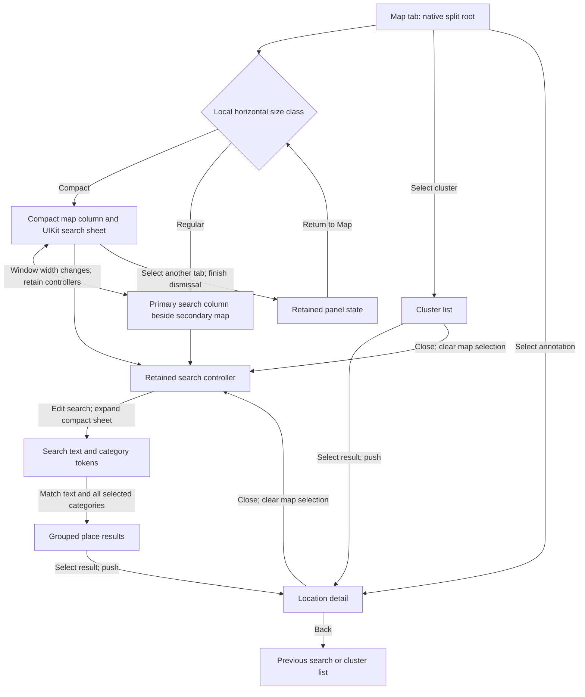

# Map presentation

The city map keeps search visible, as in Apple Maps. A narrow window uses a persistent UIKit sheet with compact, medium, and large detents. A wide window uses a UIKit split view with search beside the map. The Map tab owns the `UISplitViewController` subclass directly. One navigation controller owns search, cluster results, and location details in both layouts. The split view has no extra container or outer navigation controller, so UIKit applies the tab bar's safe area once.

The compact detent shows the search field. Dragging the system grabber reveals results at medium or large height. Search editing expands the sheet to large. The sheet does not dim the map. UIKit owns its geometry, resize gestures, scroll gestures, and compact-height presentation. Interactive dismissal is disabled so search stays available. The local presentation context keeps the app's tabs available. The panel's additional bottom safe area uses the visible bottom tab bar's frame. The compact detent includes that occlusion so the search field and place summary stay above the tabs. Top tabs need no bottom adjustment. A tab change waits for an active sheet presentation or dismissal to finish.

Search uses a native search bar, category suggestions, and grouped place results. Selected categories become editable search tokens. Text matches place names. Text and categories filter the same result set. Removing a token restores the matching places. A native empty state appears when no criteria match. List selection pushes a detail controller. Back returns to the same list with its search and filter state. Map selection replaces results with a detail above the retained search root. Close returns to compact search and clears the annotation selection. A late MapKit selection callback cannot reopen a cleared annotation. Search and cluster cells use dynamic system label colors and reload when appearance changes. Updated distances refresh existing rows.

A width change transfers the map between the split view's compact and secondary columns. The panel moves between the sheet and the primary column. It keeps the navigation stack, search text, and map instance. Controls use their local safe area. Search results use the keyboard layout guide. Compact details show the location header; route and content actions appear when the sheet has enough height. Place cards use one native grouped table, with a summary and a row of system buttons. Header sizing does not add frame animations during a sheet transition. The action row uses system blue in both appearances. Routes, phone calls, websites, camera views, editing, and history keep their existing actions. Address, opening hours, fuel price, contact details, tags, and update information use standard list content configurations. Empty or missing contact actions are omitted. A place change replaces the information and action row. Each detail cancels its location tasks when released. Native symbols support isolated previews. Table text uses dynamic system label colors and refreshes when light or dark appearance changes.

The festival map keeps its existing UIKit sheet flow. CityOS no longer exports or builds the removed drawer framework. Its source and city app license records were removed.

References: [Apple's sheet presentation API](https://developer.apple.com/documentation/uikit/uisheetpresentationcontroller), [search tokens](https://developer.apple.com/documentation/uikit/uisearchtextfield), and [native list content](https://developer.apple.com/documentation/uikit/uilistcontentconfiguration).

Focused app-hosted checks in `Moers Unit Tests/MapSheetPresentationTests` cover automatic search presentation, detents, search focus, Close and Back, suspension and return, width changes, map spacing, compact details, asymmetric safe areas, search tokens, place actions, and controller release. Sheet transition tests need the app host because the package test runner has no active app scene. `MapFeatureTests` checks the package forms and search controller lifetime. Simulator interaction checks cover search, details, map panning, and tabs.
