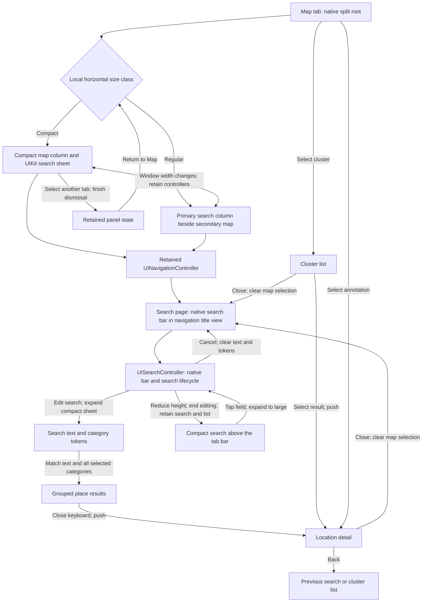

# Map presentation

The city map keeps search visible, as in Apple Maps. A narrow window uses a persistent UIKit sheet with compact, medium, and large detents. A wide window uses a UIKit split view with search beside the map. The Map tab owns the `UISplitViewController` subclass directly. One navigation controller owns search, cluster results, and location details in both layouts. The split view has no extra container or outer navigation controller, so UIKit applies the tab bar's safe area once.

The compact detent shows the search field and the top of the results list. Reducing the sheet to that height ends keyboard editing. It keeps the active search controller, field, text, and category tokens. Dragging the system grabber or scrolling the list reveals more results at medium or large height. Tapping the compact field expands the sheet to large and resumes editing. The sheet does not dim the map. UIKit owns its geometry, resize gestures, scroll gestures, and compact-height presentation. Interactive dismissal is disabled so search stays available. The local presentation context keeps the app's tabs available. UIKit supplies the panel's bottom safe area. The compact detent accounts for the visible bottom tab bar so the search field and place summary stay above the tabs. Top tabs need no height adjustment. A tab change waits for an active sheet presentation or dismissal to finish.

The search page uses its `UISearchController.searchBar` as `navigationItem.titleView`. This gives the full search field the existing navigation row, without an empty row above it. `hidesNavigationBarDuringPresentation` is false, so the field stays visible during search and after Cancel. UIKit manages activation, dismissal, and bar placement. The page never ends search itself, so it has no code to save or restore criteria. The navigation controller supplies Back for details. The content view contains only the grouped results list. UIKit's automatic scroll insets place the first rows below navigation. The keyboard layout guide protects the list's bottom edge while the keyboard is visible. When the keyboard is closed, the list fills the panel and uses automatic scroll insets for the bottom safe area, so rows can scroll behind the floating tab bar.

The persistent content page owns a standard search controller. It does not subclass `UISearchController`. This follows Apple's documented iOS pattern: install the controller's search bar in the content page, then update that page's results with `searchResultsUpdater`. A nil `searchResultsController` keeps results in the same page. Apple documents subclassing for a custom search bar, which this page does not need. Apple's Maps guide describes a search field at the top of a resizable card. Live Maps checks on iOS 27.2 confirmed that the field returns after two search Close cycles and after closing a place card. Its accessibility hierarchy reports a navigation bar and search field, but does not establish their controller classes.

Search uses category suggestions and grouped place results. Selected categories become editable search tokens. Text matches place names. Text and categories filter the same result set. Removing a token restores the matching places. The search controller reports text and token changes through `searchResultsUpdater`. A native empty state appears when no criteria match. List selection closes the keyboard and pushes a detail controller. Search stays active on its page, so Back returns to the same list with its search and filter state. Cancel is UIKit's own: it clears text and category tokens and restores all places. Map selection replaces results with a detail above the retained search root. Close returns to compact search and clears the annotation selection. A late MapKit selection callback cannot reopen a cleared annotation. Search rows and section headings use dynamic system label colors. The cluster list reloads when appearance changes. Updated distances refresh existing rows.

A width change transfers the map between the split view's compact and secondary columns. The panel moves between the sheet and the primary column. Active search stays with its page through a width or tab change. The panel keeps the navigation stack, search text, category tokens, and map instance. Controls use their local safe area. Search results use the keyboard layout guide. Compact details show the location header; route and content actions appear when the sheet has enough height. Place cards use one native grouped table, with a summary and a row of system buttons. Header sizing does not add frame animations during a sheet transition. The action row uses system blue in both appearances. Routes, phone calls, websites, camera views, editing, and history keep their existing actions. Address, opening hours, fuel price, contact details, tags, and update information use standard list content configurations. Empty or missing contact actions are omitted. A place change replaces the information and action row. Each detail cancels its location tasks when released. Native symbols support isolated previews. Table text uses dynamic system label colors and refreshes when light or dark appearance changes.

The festival map keeps its existing UIKit sheet flow. CityOS no longer exports or builds the removed drawer framework. Its source and city app license records were removed.

References: [Apple's sheet presentation API](https://developer.apple.com/documentation/uikit/uisheetpresentationcontroller), [search controller composition](https://developer.apple.com/documentation/uikit/uisearchcontroller), [search bar placement and subclassing](https://developer.apple.com/documentation/uikit/uisearchcontroller/searchbar), [Maps search card](https://support.apple.com/guide/iphone/search-for-places-iph1df24639/ios), [search tokens](https://developer.apple.com/documentation/uikit/uisearchtextfield), and [native list content](https://developer.apple.com/documentation/uikit/uilistcontentconfiguration).

Focused app-hosted checks in `Moers Unit Tests/MapSheetPresentationTests` cover automatic search presentation, shrinking active search above the tab bar, detents, search focus, Close and Back, suspension and return, width changes, map spacing, compact details, asymmetric safe areas, search tokens, place actions, and controller release. Sheet transition tests need the app host because the package test runner has no active app scene. `MapFeatureTests` checks the package forms and search controller lifetime. Simulator interaction checks cover search, details, map panning, and tabs.
