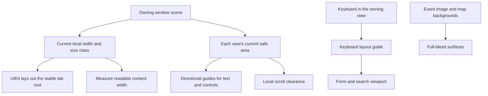
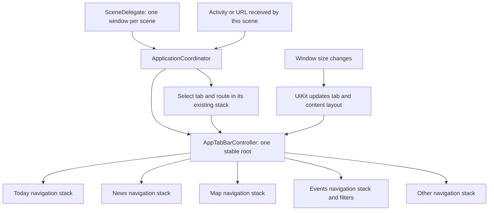

# City app resizability check

Initial check: 2026-10-02. Scope: the city iOS app, its local CityOS package, and city widgets. Existing festival changes and shared-code changes were preserved. The current navigation root is described in the 2026-10-05 section below.

## App settings

The source plist, city xcconfig files, and evaluated Moers target settings pass the three prerequisite checks. No plist or build setting was changed.

| Check | Result |
| --- | --- |
| Launch screen | `UILaunchStoryboardName` selects `Launch Screen`. |
| iPad orientations | Portrait, upside-down portrait, landscape left, and landscape right are declared. |
| Full-screen restriction | `UIRequiresFullScreen` and its version exception are absent. |
| Device families | The target supports iPhone and iPad; minimum iOS version is 17. |
| Scene lifecycle | The scene manifest and `SceneDelegate` already create a window and coordinator for each scene. Multiple scenes are enabled. |

The camera controller has an `allButUpsideDown` orientation policy. This policy was retained.

## Changes

Readable content now measures the space offered to its own SwiftUI view. A background `GeometryReader` preserves the content height inside a vertical scroll view. A live local measurement controller reads the readable guide and receives Dynamic Type from the SwiftUI environment. Width updates are deferred to avoid changing SwiftUI state during layout. A resize updates the readable width without a device orientation event. The live-controller changes from the concurrent festival work were preserved and reviewed.

The initial change removed an iPad-only condition from the shared split controller. The City app no longer creates that controller. Since 2026-10-05, its stable tab root keeps navigation and filter state through width changes. The shared split types remain available to other package callers.

Map forms use the keyboard layout guide and safe-area side guides. Map lists use their own automatic scroll insets. Map search stays visible in a UIKit sheet with compact, medium, and large detents. Wide windows use a UIKit split view. Both layouts keep the same search state and navigation stack. See `MAP_PRESENTATION.md`.

Event details read separate left and right insets during layout. Text and controls clear those edges. The scroll view uses automatic insets and a 16-point bottom content margin. The stack cancels the automatic top gap so the image remains under the navigation bar. The no-image layout uses the top safe area once. The automatic-inset and header-offset changes from the concurrent festival work were preserved and reviewed.

## Source coverage

All detected files were processed. Correct patterns were retained. No change was made to a file only to create a diff.

| File or group under `ios/` | Result |
| --- | --- |
| `CityOS/Sources/Core/UI/ReadableContentWidth.swift` and `ReadableContentWidthMeasurement{,Controller}.swift` | Replaced main-screen measurement and orientation-only updates. Current live measurement handles local traits, safe-area changes, and Dynamic Type. |
| `CityOS/Sources/AppScaffold/Split/SplitViewController.swift` | Initial shared change removed the iPad-only restoration condition. City no longer instantiates this controller. |
| `CityOS/Sources/MapFeature/SeachController/LFSearchViewController.swift` | Keyboard guide replaces notification-driven insets. |
| `CityOS/Sources/MapFeature/Entry Onboarding/EntryOnboarding{Address,General,OpeningHours,Overview}ViewController.swift` | Keyboard guide and safe-area side constraints. |
| `CityOS/Sources/MapFeature/Entry Onboarding/EntryOnboarding{Tags,LocationMenu}ViewController.swift` | Safe-area side constraints. |
| `CityOS/Sources/MapFeature/Controller/SelectionViewController.swift` | Cluster results use a standard list inside a sheet navigation controller. The unused content drawer was removed. |
| `CityOS/Sources/MapFeature/View/SearchDrawerViewController.swift` | The UISearchController uses the existing navigation row and keeps its field visible during search and after dismissal. Active search stays with the page through panel transfers, with its text and category tokens. |
| `CityOS/Sources/MapFeature/View/SearchDrawerView.swift` | The list fills the panel with automatic scroll insets. The keyboard layout guide protects the bottom edge only while the keyboard is visible. |
| `CityOS/Sources/MapFeature/Controller/Detail/DetailViewController.swift` | System sheet navigation and safe-area content constraints. |
| `CityOS/Sources/MapFeature/Controller/Detail/MapPlaceHeaderView.swift` | Native action buttons use a vertical layout at accessibility text sizes and in narrow columns. The old detail child controllers and storyboard were removed. |
| Both city and package `Controller/Community/MapLocationPickerViewController.swift` / `MapFeature/Controller/MapLocationPickerViewController.swift` | Safe-area guides protect labels and location control; map remains full width. |
| `Moers/Other/About/AboutViewController.swift` | Safe-area side and bottom constraints. |
| `CityOS/Sources/Events/UI/View/EventDetailView.swift` | Current side and bottom clearance; preserved full-bleed media layout. |
| `CityOS/Sources/Core/Extensions/ViewController+Extensions.swift` | Existing changes retained. Safe-area helpers are already local. |
| `Moers/Common/Extensions/Extensions.swift`, `CityOS/Sources/MapFeature/Utility/Extensions.swift` | Correct directional safe-area helpers. |
| `CityOS/Sources/Core/Location Preview/View/LocationPreviewView.swift` | Readable guide protects controls. Map remains full bleed. |
| `CityOS/Sources/AppScaffold/UI/SettingsRowContentConfiguration.swift` | Correct local margin-guide constraints. |
| `CityOS/Sources/Events/UI/Cells/{EventHeaderFooterView,EventTableViewCell,HintTableViewCell}.swift` | Correct local margin guides. |
| `CityOS/Sources/MapFeature/View/{AuditTableViewCell,EntryValidationTableViewCell,SearchResultTableViewCell,TagTableViewCell}.swift` and `Moers/Common/View/SwitchTableViewCell.swift` | Correct local margin guides. |
| `CityOS/Sources/MapFeature/Controller/{MainMapViewController,MapViewController,SheetContentViewController}.swift` | Full-bleed map or native bar backgrounds; current system geometry. |
| `CityOS/Sources/Events/UI/{EventsViewController,EventsViewController_Legacy}.swift`, `CityOS/Sources/Feeds/UI/ViewController/PostsViewController.swift`, `Moers/Events/EventsViewController.swift`, `Moers/Controller/CardCollectionViewController.swift` | Correct automatic scroll handling. Designed section padding remains. |
| `CityOS/Sources/AppScaffold/Sidebar/SidebarViewController.swift`, `CityOS/Sources/DashboardFeature/Controller/EditDashboardViewController.swift`, `CityOS/Sources/MapFeature/Controller/CameraViewController.swift` | Automatic scroll handling. Camera orientation policy is unchanged. |
| City `Other/Controller/{SettingsViewController,LegacySettingsViewController,OtherViewController,PrivacyViewController,TandCViewController,DebugViewController,EntryValidationViewController}.swift` | Safe-area or automatic scroll handling. |
| `CityOS/Sources/AppScaffold/Extensions/UIViewController+Extensions.swift`, `CityOS/Sources/Events/Events/Overview/TimetableSearchViewController.swift` | Hosting views keep the parent boundary. SwiftUI receives local safe areas. |
| `CityOS/Sources/Core/UI/ContainerView.swift`, `CityOS/Sources/MapFeature/View/OnboardingProgressView.swift`, city event cells and `Moers/Common/BulletinBoard/SelectorBulletinPage.swift` | Caller-supplied content or cell margins, not system inset copies. |
| `CityOS/Sources/Core/UI/{Button Styles/LiquidGlassButtonStyle,Map/BaseMap,Shadows}.swift`, `CityOS/Sources/EFAUI/Trip/ActiveTripScreen.swift`, `CityOS/Sources/Tours/StationMapView.swift`, `CityOS/Sources/ParkingFeature/UI/ParkingAreaList.swift` | Background or map safe-area extensions; readable side edges remain protected. |
| `CityOS/Sources/Core/Radio/BroadcastDetail.swift` | Bottom-only extension is in a dormant recommendations helper. No current side-inset defect. |
| Remaining tour, parking, transit, feed, radio, event collection, rubbish, and Explore card matches | Design spacing or artwork. No system inset arithmetic found. |
| City news widgets | Read the offered widget size; do not subtract safe-area insets. |
| `Moers/Common/View/PickerView.swift` | Fixed-height city caller; no current resize defect established. |
| `CityOS/Sources/Core/UI/PageView/PageView.swift` | Device idiom appears only in a comment. |
| `Moers/AppDelegate.swift`, `Moers/Config/SceneDelegate.swift`, city plist | Scene migration is already complete. Empty application lifecycle stubs have no work to move. |

## Findings from 2026-10-02

The resize navigation loss and size-trait activity replay in the first two bullets were removed by the tab navigation change on 2026-10-05. The process-wide fallback during scene restoration remains. Other findings below still need their recorded checks.

- Resize loses state in the current build. On Duo, an Events Today filter is cleared on opening the device. Selecting Map in the regular sidebar and closing the device can select Events. On iPad, narrowing an open event detail returns to the Events list. Compact and regular presentations use separate coordinators. The source already used global activity restoration on iPad; the removed idiom guard exposes that same design defect on Duo. The old build was not run, so the check does not claim identical prior Duo behavior.
- Resize restoration and scene restoration still read process-wide `UserActivity.current`. One window can restore another window's page. A complete fix must move all activity writers and readers to their owning scene.
- Events horizontal filter and featured-card sections enter the right system area on Duo. Regular event rows respect that area. Section clipping and available width need a separate layout fix.
- Cold scene connection handles user activities but not URL contexts. A widget URL can be lost on initial launch.
- The shared event timer and subtitle consumers still include application lifecycle notifications. Migrate activation and timer restart together to the owning scene. These shared event-list controllers are separate from the current city Events tab.
- The map address form has a pre-existing negative-width street-field constraint. It needs a separate form-layout fix.

The actionable findings are also recorded in `PAPERCUTS.md`.

## Initial validation — 2026-10-02

Xcode built and launched the city app on iPhone Duo iOS 27.1 and iPad Pro 11-inch (M5) iOS 27.2 simulators with no build errors.

Seven focused checks passed across the final runs on the iPad simulator:

- Readable width follows a 320 → 1024 → 320-point resize without an orientation event. Long text keeps enough height to scroll.
- Form controls follow separate left and right insets in both layout directions.
- Form and search controllers ignore keyboard-frame notifications from another window.
- Event-detail text and adjusted bottom clearance follow inset-only changes.
- Both existing content-controller lifetime checks pass.

The selected iOS 27.0 simulator could not load its runtime. Tests used the installed iOS 27.2 iPad runtime instead.

The Duo device check used the same app process at 466 × 678 points closed and 951 × 669 points open. Dashboard, Events, search, filter, and Map were usable at each size. The wide layout displayed a sidebar. Filter loss, the Map → Events selection change, and Events section clipping were observed during this check.

The iPad device check used the same process in portrait at 834 × 1210 points, landscape at 1210 × 834 points, and a narrow window at 375 × 651 points. Dashboard, sidebar, Events search and filter controls, and event rows fit the available space. The narrow window changed to compact tabs. An event image remained under the navigation controls, title and body text were readable, and the last website button scrolled clear of the bottom edge. Resizing that detail to the narrow window returned to the Events list.

Xcode captures the closed Duo display correctly, but produces a black or stale capture after opening it. The open-display evidence came from the native DeviceHub UI. The software keyboard and two simultaneous app scenes were not exercised.

Preserved local visual evidence: [Duo Events](/Users/lennart/.codex/visualizations/2026/10/02/01a0fd82-0eed-76f2-8e6b-d2ccc9aa4b4e/duo-closed-events.png), [filter before resize](/Users/lennart/.codex/visualizations/2026/10/02/01a0fd82-0eed-76f2-8e6b-d2ccc9aa4b4e/duo-closed-filter.png), and [wrong selection after closing from Map](/Users/lennart/.codex/visualizations/2026/10/02/01a0fd82-0eed-76f2-8e6b-d2ccc9aa4b4e/duo-close-from-map-wrong-events.png).

iPad evidence: [image detail](/Users/lennart/.codex/visualizations/2026/10/02/01a0fd82-0eed-76f2-8e6b-d2ccc9aa4b4e/ipad-landscape-event-image.png), [last detail control](/Users/lennart/.codex/visualizations/2026/10/02/01a0fd82-0eed-76f2-8e6b-d2ccc9aa4b4e/ipad-landscape-event-bottom.png), and [narrow window after detail loss](/Users/lennart/.codex/visualizations/2026/10/02/01a0fd82-0eed-76f2-8e6b-d2ccc9aa4b4e/ipad-narrow-events.png).

SwiftLint was compared with the pre-change source. Existing file-size and style findings remain. The current readable-width helper and all three new test files have no lint findings. The scoped whitespace check passes. Existing user edits to the Core view-controller extension match the saved baseline.

No commit, push, release, signing, or deployment workflow was requested or run.

## Tab navigation change — 2026-10-05

The City scene now uses `AppTabBarController` as its root at every window size. Each section has one coordinator and one navigation stack. UIKit places the tabs for the available space. On iOS 18 and later, the root selects `.tabBar` mode. On iOS 17, it uses the standard tab bar.

`ApplicationCoordinator` no longer selects between compact and regular coordinators. It no longer replays `UserActivity.current` when size traits change. A resize keeps the selected tab, detail controller, search text, and filters in the same controller tree. An explicit route still selects its section and opens the requested page.

The removed City files are `AppSplitViewController`, `AppSidebarViewController`, `SidebarItem`, and `SidebarSection`. The shared AppScaffold sidebar API remains, although neither app currently creates it. Festival uses its own adaptive split controller. Removing that public package API is outside this navigation change. Onboarding, rubbish schedule revalidation, migration bulletins, snapshot setup, and dashboard refresh now belong to the tab root. Both Settings controllers refresh that root. The map background now uses the dynamic system background, so the area behind the native iPad tabs follows the current appearance instead of showing a fixed black strip.

Events search uses UIKit's stacked search row and keeps the navigation bar visible during search. The default integrated search presentation hid the native iPad tabs and Filter, including after keyboard submission. The explicit placement keeps those controls available without adding a custom search or navigation control.

The current prerequisite source check confirms the launch storyboard, four iPad orientations, and no full-screen restriction across the plist, project, and three City xcconfig files. No settings changed. The scene lifecycle already creates a window and coordinator per scene.

### Skill coverage

| Task | Result for this change |
| --- | --- |
| Main screen | No active `UIScreen.main` use in City or CityOS. |
| Orientation | No layout orientation check. Camera orientation policy remains. |
| Scene lifecycle | The root already uses `SceneDelegate`. Existing shared event activation/timer work stays recorded as a separate issue. |
| Safe areas | The tab root uses UIKit layout. Local inset readers update during layout; no inset cache or symmetry assumption needs replacement in the shell. |
| Device type | No device-type layout branch remains in the root. Platform-specific rendering branches remain. |

The process-wide activity fallback in scene restoration and initial URL-context handling remain separate issues. They do not run on window resize after this change.

### Current validation

Three new unit tests passed on iPad Pro 11-inch (M5), iOS 27.2. They check the selected section and pushed detail through 375 → 1024 → 375-point layout, stable root access, and activity routing through the existing section stacks.

The Duo device check used native DeviceHub controls. Settings remained open through tab switching and a fold cycle. Map stayed selected through Closed → Open → Closed. The Today event filter and selected Events tab also remained through tab switching and folding. The app process stayed PID 25208. Explicit display captures show 1398 × 2034 pixels closed and 2853 × 2007 pixels open; the simulator reports scale 3. These are display sizes, not direct scene-bound measurements.

Evidence: [closed Duo tabs and filter](/Users/lennart/.codex/visualizations/2026/10/05/01a10c16-bc0f-7011-9e61-0b0c97cb78d3/duo-closed-events-tabs.png), [open Duo tabs and filter](/Users/lennart/.codex/visualizations/2026/10/05/01a10c16-bc0f-7011-9e61-0b0c97cb78d3/duo-open-events-tabs.png).

The native tabs use UIKit's platform placement. The Duo displays a floating tab strip on the right. No custom sidebar or sidebar toggle appears.

The Xcode device session and Screenshot action failed. A CLI capture worked after enumerating the simulator displays and selecting each display explicitly. The default capture selected an inactive display and produced a black image.

The first iPad UI run exposed UIKit's nested accessibility entries for floating tabs. Each tab's outer item and inner button use the same identifier. The test selectors now choose the first match. The failed run stopped during diagnostics collection and was terminated before the corrected run.

The isolated `AppTabBarControllerPreview` provides the real tab root while omitting its startup appearance actions. It compiled in the UI builds; a preview render was not checked. Scoped SwiftLint reports no findings in the navigation, preview, or test files. Existing style findings in Settings, Map, and Events remain.

Seven focused tests passed across the final runs on the full-window iPad simulator: three navigation unit tests, two tab UI tests, one Events UI test, and one onboarding UI test. The tab tests check Settings and Map state through portrait/landscape rotation, absence of the sidebar control, and persistent tab labels after detail navigation. The Events test checks search input, available tabs after search, filter changes and reset, and Events → Map → Events selection. The onboarding test checks the intro, privacy, user type, and notifications pages after the lifecycle move.

The first onboarding run lost the XCTest launch connection before it could check controls. OS logs showed a live app window and the onboarding bulletin, with no app crash. The retry passed with code coverage off. Final UI runs disabled test diagnostics collection to avoid the earlier collection stall.

A native iPad check also kept Settings and Map state through portrait → landscape → portrait in one app process. Two attempts to use the simulator's app resize grip did not change the window geometry. Live narrow iPad window resizing remains unverified; the unit resize test covers narrow/wide layout changes.

The final retained UI captures confirm the Map background fix in light appearance and the Events search row with all five tabs and Filter visible. Evidence: [Map with native tabs](/Users/lennart/.codex/visualizations/2026/10/05/01a10c16-bc0f-7011-9e61-0b0c97cb78d3/ipad-portrait-map-tabs-fixed.png), [Events after search and filter reset](/Users/lennart/.codex/visualizations/2026/10/05/01a10c16-bc0f-7011-9e61-0b0c97cb78d3/ipad-portrait-events-tabs-search.png).

The 2026-10-05 scope check preserved all 36 pre-existing files outside the two documentation files updated for that change. No commit or push was made in that check. The later Events review fixes and minimal package-lock correction are described in `EVENTS.md`.
