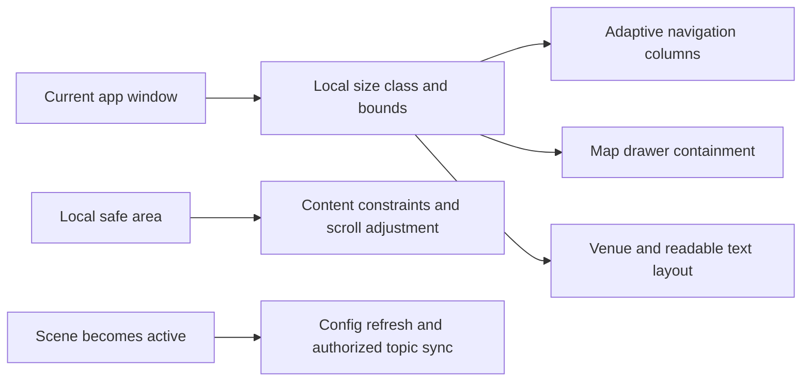
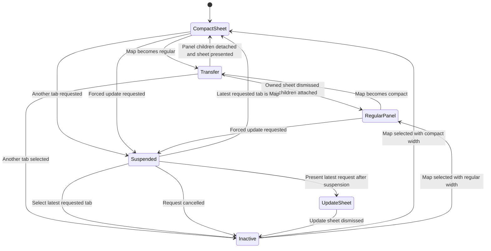
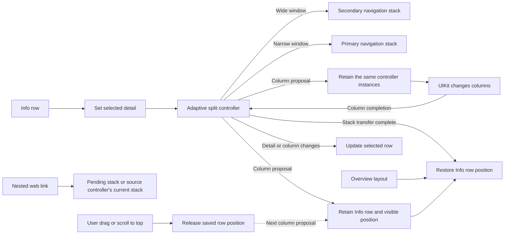
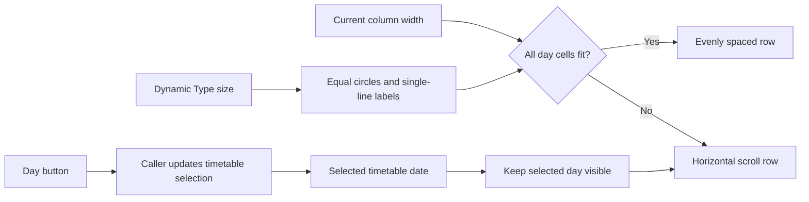
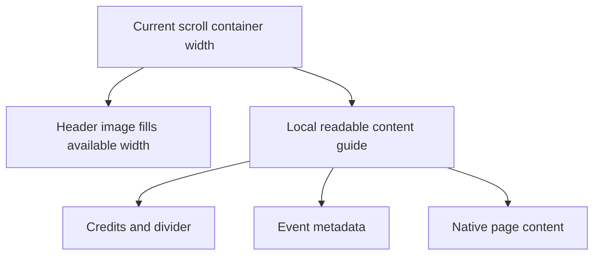

# Festival iOS resizability

Scope: the festival iOS app and the first-party CityOS code that it links. The minimum iOS version is 17. The initial worktree was clean on `feature/city-events-redesign` at `9e26800acc95e40dd32c47c84811ba7705b69739`.

## Configuration results

- Launch storyboard is declared.
- All four iPad orientations are declared.
- Full screen is not required.
- Scene configuration and a scene delegate exist. Multiple app windows are disabled.
- Configuration keys are unchanged.

## Implemented changes

The user approved all seven remaining proposals on 2 October 2026. Existing local city-app and shared-package changes are preserved.

| Surface | Result |
| --- | --- |
| Scene activation | `SceneDelegate.sceneDidBecomeActive` refreshes configuration and synchronizes authorized notification topics. All four obsolete AppDelegate callbacks are removed. App setup stays in AppDelegate. |
| Readable text width | A mounted UIKit controller measures the current SwiftUI container's readable guide. Container size, local traits, safe area, and SwiftUI Dynamic Type update the measurement. Only the latest valid width is delivered after layout. The public modifier stays the same. |
| Programme and saved programme | Every device uses the adaptive split controller. Column-style collapse/expand callbacks move the existing detail stack between primary and secondary navigation controllers. Nested venue pushes use the active content column. Search keeps its modal navigation path. |
| Map drawer | Local horizontal size class selects a sheet or overlay panel. Transfers reuse the drawer, collection view, search text, venue navigation stack, and map. The saved sheet detent survives a round trip. A transition gate uses the latest size class, tab selection, and queued venue selection. UIKit owns the sheet container in the map's presentation context. Forced update requests use the latest publisher value and finish Map suspension before presentation. |
| Countdown | Retained label constraints change their margins with the local horizontal size class: 16 points in compact width and 0 in regular width. |
| Venue detail | Normal venue screens read their live SwiftUI horizontal size class. A map overlay explicitly requests the existing card layout through a retained observable layout state. Transfer back to a sheet restores automatic layout. The model, hosting controller, and expansion state stay in place. |
| Legacy event detail | UIKit supplies automatic scroll insets. Explicit bottom spacing is 16 points. A content-origin correction retains the image behind the bar and the no-image safe-top spacer. Text uses the visible viewport's separate horizontal safe areas. The legacy stretch offset is relative to the adjusted top inset. |

## File queue

All detected festival targets are implemented or explicitly excluded below. Additional helper and test files are listed with their callers.

- [x] `ios/moers festival/moers festival/ApplicationController.swift`: local size class for browser presentation.
- [x] `ios/moers festival/moers festival/Controller/TabBarController.swift`: local browser presentation and coordinated Map suspension/resumption. Finish suspension before selecting the latest requested tab. Coalesce pending forced update requests. Keep the local iPad system-tab mode policy.
- [x] `ios/moers festival/moers festival/Coordinator/OtherCoordinator.swift`: adaptive Info & Tickets columns and local web navigation.
- [x] `ios/moers festival/moers festival/Extensions/Extensions.swift`: replace legacy layout guides; keep availability branches.
- [x] `ios/CityOS/Sources/Core/Extensions/ViewController+Extensions.swift`: replace legacy layout guides; keep availability branches.
- [x] `ios/moers festival/moers festival/Venues/Controllers/NewMapViewController.swift`: dynamic containment, retained state, local safe area, and serialized presentation.
- [x] `ios/moers festival/moers festival/Venues/Controllers/MapPanelContainerController.swift`: child transfer, panel safe areas, and reactive border display scale.
- [x] `ios/moers festival/moers festival/Venues/Controllers/MapPanelState.swift`: separate panel-state type.
- [x] `ios/moers festival/moers festival/Venues/Controllers/MapPanelPassthroughView.swift`: separate panel hit-test type.
- [x] `ios/moers festival/moers festival/Venues/Drawer/TabSheetPresentationController.swift`: supported local-context presentation; UIKit owns container layout.
- [x] `ios/moers festival/moers festival/Venues/Drawer/TabSheetTransitioningDelegate.swift`: restore the saved detent.
- [x] `ios/CityOS/Sources/Pulley/PulleyViewController.swift`: use local idiom for the existing bounce workaround. Keep Catalyst workarounds.
- [x] `ios/moers festival/moers festival/Venues/Drawer/NewMapDrawerViewController.swift`: remove cached tab-bar inset; retain search and collection state and notify after appearance.
- [x] `ios/moers festival/moers festival/User Schedule/UserScheduleViewController.swift`: both horizontal safe-area edges.
- [x] `ios/CityOS/Sources/MMEvents/UI/View/EventDetailView.swift`: local width/height header invalidation, automatic insets, header origin, and separate horizontal safe areas.
- [x] `ios/CityOS/Sources/Core/UI/ReadableContentWidth.swift`: preserve the public modifier and use the mounted measurement bridge.
- [x] `ios/CityOS/Sources/Core/UI/ReadableContentWidthMeasurement.swift`: local SwiftUI container and Dynamic Type bridge.
- [x] `ios/CityOS/Sources/Core/UI/ReadableContentWidthMeasurementController.swift`: local guide measurement, trait invalidation, coalesced reporting, and removal cleanup.
- [x] `ios/moers festival/moers festival/Controller/AdaptiveTabSplitViewController.swift`: current column-style callbacks and retained detail stacks.
- [x] `ios/moers festival/moers festival/Coordinator/EventCoordinator.swift`: adaptive split on every device.
- [x] `ios/moers festival/moers festival/User Schedule/UserScheduleCoordinator.swift`: adaptive split on every device.
- [x] `ios/moers festival/moers festival/Coordinator/SharedCoordinator.swift`: active content navigation and automatic venue context; capture modal presenter before storing the new modal.
- [x] `ios/moers festival/moers festival/Coordinator/MapCoordinator.swift`: automatic venue context.
- [x] `ios/moers festival/moers festival/Controller/Live/CountdownViewController.swift`: dynamic label margins.
- [x] `ios/moers festival/moers festival/Venues/Venue/VenueDetailController.swift`: retained layout state, clear host background, close and presentation-completion callbacks.
- [x] `ios/moers festival/moers festival/Venues/Venue/VenueDetailScreen.swift`: live size class and preserved expansion state.
- [x] `ios/moers festival/moers festival/Venues/Venue/VenueDetailPresentationContext.swift`: separate context type; local size class in the compatibility helper.
- [x] `ios/moers festival/moers festival/Venues/Venue/VenueDetailLayoutState.swift`: observable containment intent without replacing the SwiftUI root.
- [x] `ios/moers festival/moers festival/AppDelegate.swift`: remove the four obsolete lifecycle callbacks together.
- [x] `ios/moers festival/moers festival/SceneDelegate.swift`: run both activation calls in the owning scene callback.

The focused validation files are `FestivalResizabilityTests.swift`, `AdaptiveTabSplitResizabilityTests.swift`, `MapDrawerResizabilityTests.swift`, and `ForcedUpdateResizabilityTests.swift` in the festival test target, plus `CoreTests/ReadableContentWidthTests.swift` and `MMEventsTests/ViewModel/EventDetailLayoutTests.swift` in CityOS. The latter two files contained local work before this implementation; their checks are extended or adapted to the approved behavior.

## Explicit exclusions

- Camera orientation mask: preserve the permitted orientations. A mask is not a direct replacement for orientation locking.
- Global review-scene helper and app-level activation/timer observers: outside the skill's AppDelegate migration. Record their impact in PAPERCUTS.
- Full-bleed map, media, gradients and backgrounds: keep their edge constraints.
- Map panel width already subtracts left and right insets separately and updates during layout.
- Watch, tvOS, Android and external package code: outside this iOS app check.

## Info & Tickets split layout

Follow-up scope on 3 October 2026: use the existing adaptive split for Info & Tickets. The list stays in the primary column. The selected web page or native screen uses the secondary column. Narrow width moves the same detail stack into the primary navigation controller. The column proposal retains the whole stack; the completion callback installs it after UIKit changes columns. A temporary root display during this transfer is not treated as Back. Nested web links update the pending stack during a column change, or use their source controller's current navigation controller afterward. The selected row stays marked only in wide windows. An overview route or compact Back clears the detail and its row selection.

The Info list retains its first visible row and that row's position in the visible area before the column change or overview departure. It restores this position after the stack transfer and overview layout. Intermediate column changes cannot replace the saved position. A user drag or scroll-to-top releases it. Automatic safe-area insets and the readable-content list layout stay in use. Long Info row titles can wrap in the narrow primary column.

Follow-up file queue:

- [x] `Coordinator/OtherCoordinator.swift`: adaptive root, web and native detail routes, overview reset, and isolated wide/narrow previews.
- [x] `Controller/AdaptiveTabSplitViewController.swift`: retained column transfer, pending nested links, selected detail identity, and column-start/detail-change callbacks.
- [x] `Controller/Other/OtherViewController.swift`: retain the detail's wide row selection and restore the visible list position until the user scrolls again.
- [x] `ApplicationController.swift`: reset both Info columns for overview routes.
- [x] `Controller/TabBarController.swift`: use the concrete Info web route.
- [x] `Assets/Localizable.xcstrings`: English/German empty-detail prompt.
- [x] `moers festival Tests/OtherCoordinatorResizabilityTests.swift`: routes, nested links, resize, and selection checks.
- [x] `moers festival Tests/AdaptiveTabSplitResizabilityTests.swift`: temporary primary-root restoration with the same nested detail stack.
- [x] `ViewModels/Main Views/Other/OtherDataSource.swift`: allow Info row titles to wrap.
- [x] `ios/CityOS/Sources/AppScaffold/UI/SettingsRowContentConfiguration.swift`: opt-in title line count, with the current one-line default.

`OtherView` already sizes its list from the local readable-content area. It needs no layout change. Staff bulletins and external review/developer actions are outside this column-routing change.

Fourteen focused tests pass on iPhone 16e with iOS 18.6: ten Info tests and four adaptive split tests. They cover all nine web topics, four native destinations, nested web Back, controller identity across repeated size changes, row restoration, compact Back, immediate overview reset, and application/tab web routes. Added regression checks cover UIKit's temporary primary-root restoration, pending web links and topic/reset requests, window geometry changes inside the tab controller, list-position restoration after hidden and intermediate layouts, and later user scrolling/scroll-to-top. The source review passes. The English/German string catalog is valid JSON. The stack-transfer state supplies row marking because UIKit can report the previous `isCollapsed` value in the collapse callback.

After the title-wrapping change, the three list/selection/window tests passed again. Focused SwiftLint completed with no errors; its sixteen warnings are in existing source. The final source and test files contain no temporary trace code.

The final build installed and ran on Duo with iOS 27.1. Native About passed an immediate 951-by-669 → 466-by-678 → 951-by-669-point fold round trip. The app process, About screen, Info tab, selected row, and list position remained the same. The 340-point primary column showed Awareness and Accessibility on two lines. Before and after the fold, Volunteers stayed at y=74.7 points. Later user scrolls moved the list. The public Festival Village page loaded in the secondary column and stayed visible across the fold. Compact Back returned to the Info overview; opening then showed the empty detail prompt with no selected topic.

Two device checks remain incomplete. A later overview returned to the top after snapshot/session operations and native window reselection, while About and Info remained selected. The cause is unverified. The comparison without snapshot sessions could not start because two guarded Device Hub recovery attempts selected other device windows. No input was sent to those devices. Live nested web Back also remains unverified: the hierarchy tap had no effect and the native-coordinate fallback failed with `windowNotFoundAtPosition`. The focused tests cover nested web Back. The original Programme/Map/rotation smoke checks did not start during this follow-up.

## Programme date strip follow-up (4 October 2026)

Scope: correct the wrapped `22` in the 340-point programme column. The same shared selector serves compact, image, and venue-grid modes. Each circle uses the same size, day text stays on one line, and the row scrolls when its content cannot fit. Selection stays in the caller's timetable model.

File queue:

- [x] `ios/CityOS/Sources/MMEvents/Events/Overview/DayItem.swift`: equal circles, single-line date text, and Dynamic Type.
- [x] `ios/CityOS/Sources/MMEvents/Events/Overview/DaySelector.swift`: equal cells, fitting row or horizontal scroll, selected-date visibility, and isolated previews.
- [x] `ios/CityOS/Tests/MMEventsTests/ViewModel/DaySelectorLayoutTests.swift`: focused width, text-size, and scroll regression checks.
- [x] `PAPERCUTS.md`: record the result for the reported date-strip issue.
- [x] This report: record source, test, and device evidence.

Five focused `DaySelectorLayoutTests` pass on iPhone 16e with iOS 18.6. They check two-digit day height under width compression, English/German row height at 308/340/420 points, scrolling across 200/160/600/200-point widths, a selected date with a different time component, accessibility text sizes 3 and 5, a date added before the same selected day, changed selection, and header space above the compact event pages. Source review passes. Focused SwiftLint reports no warnings or errors.

The current festival build installed and launched on Duo iOS 27.1, PID 31620. Its 951-by-669-point window has a 340-point programme column. Native UI shows five equal circles and aligned single-line day numbers and weekday captions. Tapping `22` marks Friday as selected and changes Thursday's Workshop/WDR rows to Friday's moersify/Clemens Köhler/Workshops rows. The 466-by-678-point Closed/Open round trip retains Friday, the selected Schedule tab, Friday's event rows, and PID 31620. All five day numbers and captions stay aligned on one line in both sizes. Larger text is covered by the hosted tests; no simulator text-size preference was changed.

Native screenshot reviewed: `/private/tmp/festival-date-strip-20261004.png`, copied from `/Users/lennart/Desktop/Screenshot iPhone Duo 04.10.2026 at 00.39.27.png`. Closed screenshot: `/Users/lennart/Desktop/Screenshot iPhone Duo 04.10.2026 at 00.36.08.png`.

AX before/after: `/var/folders/c3/nhvb43vd6458kcrgjf45v56w0000gn/T/ActionArtifacts/default/DeviceInteractionSynthesize/Festival Programme Friday Before Fold-00_34_18_161-hierarchy.txt` and `Festival Programme Friday After Fold-00_38_50_584-hierarchy.txt` in the same directory. All standalone interaction sessions closed; workspace aliases had expired. Xcode screenshots were black, so native screenshots supplied the visual check.

The workspace device session expired during InstallAndRun on two bounded attempts. Xcode reported a successful current build each time. The exact build product was installed and launched through simulator tooling. No app data was reset.

Test result: `/var/folders/c3/nhvb43vd6458kcrgjf45v56w0000gn/T/ActionArtifacts/default/RunSomeTests/D8196AA9-6976-4160-B105-ABBCA8298B6F.txt`.

## Validation

- The implemented festival app built, installed, and launched on iPhone Duo with iOS 27.1. The current UI hierarchy confirms a 951-by-669-point window, a 340-point programme primary column, cached events, and the detail placeholder.
- The initial audit verified a 466-by-678 to 951-by-669-point fold change. The active timetable filter remained set. The filter controls, five day buttons, empty-state text, and all five tabs remained visible without overlap. This earlier visual check does not prove the later navigation and Map changes.
- Eighteen focused tests pass across iOS 18.6 and iOS 27.2. The eight initial festival layout and adaptive-navigation tests passed on iPhone 18 Pro with iOS 27.2. The five festival layout tests and four shared-package tests passed on iPhone 16e with iOS 18.6.
- The final seven-test run passed on iPhone 16e with iOS 18.6. It covers Map drawer and venue transfer, a queued second venue selection, immediate tab return, forced-update replacement and cancellation during a queued tab change, and the legacy stretchy header with automatic insets.
- Shared tests cover mounted readable-guide measurement, Dynamic Type, coalesced width updates, and event text with unequal horizontal safe areas. Navigation tests retain selected and nested controllers, scroll position, pre-appearance selection, and search navigation.
- Focused SwiftLint checks pass. Remaining warnings are in existing source. No new helper or test warning remains.
- Source review found no missing safe replacement. `git diff --check` passes.
- DeviceInteraction screenshots retained the pre-fold display geometry after opening the device. Native DeviceHub UI supplied the window-size evidence; the stale captures are a validation-tool limit.
- On 2 October, the final fold, visible state retention, Map, browser, and rotation checks were blocked by the locked Mac. CUA could not unlock it. The session had expired when cleanup was attempted. Automated tests cover these state transfers. The 3 October Info & Tickets follow-up has a separate device check; it does not complete the earlier Map and rotation checks.

## Excluded linked files

These files were detected in linked products. Festival source does not instantiate these city-only controllers, so this festival check does not change them. Their separate local edits are preserved:

- `ios/CityOS/Sources/AppScaffold/Split/SplitViewController.swift`: the existing city split controller has an iPad-only trait callback. Festival uses its own adaptive split controller.
- `ios/CityOS/Sources/MapFeature/Controller/CameraViewController.swift`: preserve the orientation mask. The festival map does not use this camera controller.
- `ios/CityOS/Sources/MapFeature/View/ContentDrawerView.swift`
- `ios/CityOS/Sources/MapFeature/View/SearchDrawerViewController.swift`
- `ios/CityOS/Sources/MapFeature/Controller/ContentViewController.swift`
- `ios/CityOS/Sources/MapFeature/Controller/SelectionViewController.swift`
- `ios/CityOS/Sources/MapFeature/Controller/Detail/DetailViewController.swift`
- `ios/CityOS/Sources/MapFeature/SeachController/LFSearchViewController.swift`
- `ios/CityOS/Sources/MapFeature/Entry Onboarding/EntryOnboardingAddressViewController.swift`
- `ios/CityOS/Sources/MapFeature/Entry Onboarding/EntryOnboardingGeneralViewController.swift`
- `ios/CityOS/Sources/MapFeature/Entry Onboarding/EntryOnboardingOpeningHoursViewController.swift`
- `ios/CityOS/Sources/MapFeature/Entry Onboarding/EntryOnboardingOverviewViewController.swift`

The initial audit found manual scroll, bar-height, and keyboard-inset handling in MapFeature. Separate local work now changes these city-only files. This festival implementation preserves that work.

`ios/CityOS/Sources/Core/UI/PageView/PageView.swift` has only a commented idiom expression. It has no executable effect. Pulley's seven Catalyst conditional sites are platform rendering workarounds; keep them. Local idiom use for the festival's UIKit tab-bar mode is an explicit system policy; keep it.

## Event image margins — 5 October 2026

The modern event screen applied `readableContentWidth()` to the whole scroll stack. This also gave the header image the readable guide's side margins on phones. The modifier now applies only to credits, their divider, event metadata, and native page content. The image uses the current container width. Its aspect ratio, clipping, and 520-point height limit remain in use. Text width still updates when the local container, traits, safe area, or Dynamic Type changes.

Files: `Controller/Events/ModernEventView.swift` and this report. The festival build and all five selected `FestivalResizabilityTests` pass on iPhone 18 Pro with iOS 27.2. Focused SwiftLint and the source diff check pass. These tests cover the existing UIKit resize and safe-area behavior. The updated app also built, installed, and ran through the device tools. The modern event detail screenshot and hierarchy show a 402-point phone window and a header at x = 0 with width = 402 points. The metadata row stays at x = 16 with width = 370 points; its complete title wraps within x = 32 and width = 338 points. This proves portrait edge alignment. Wide-window image alignment was not separately captured.
