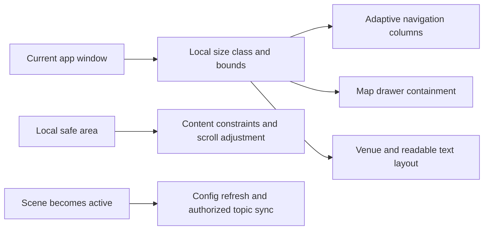
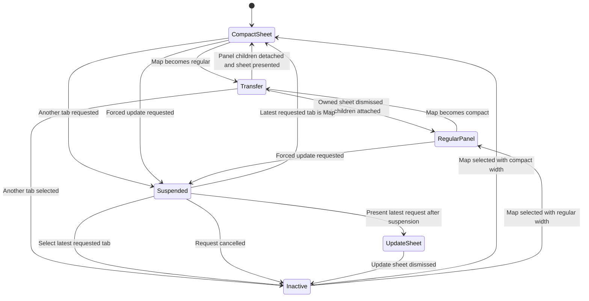
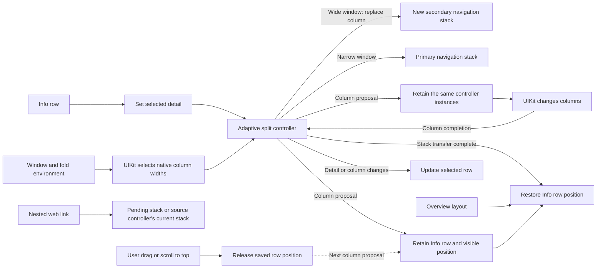
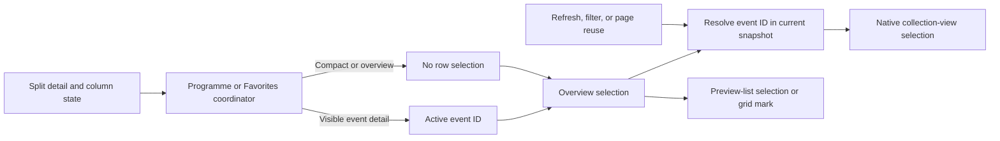
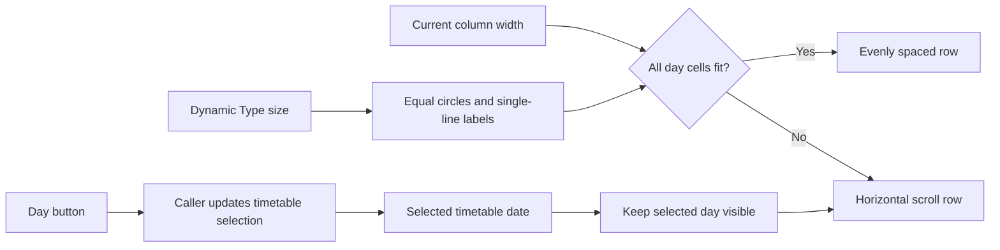
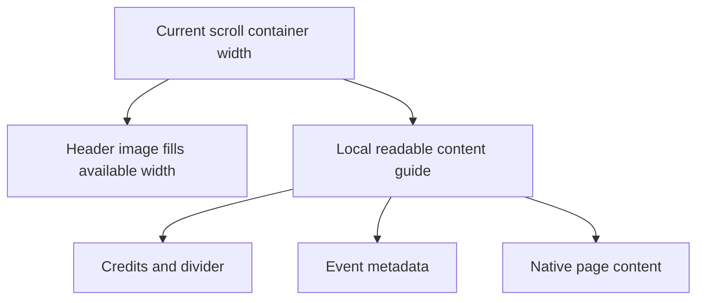
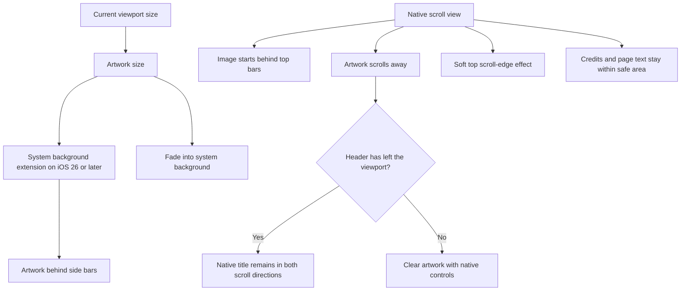
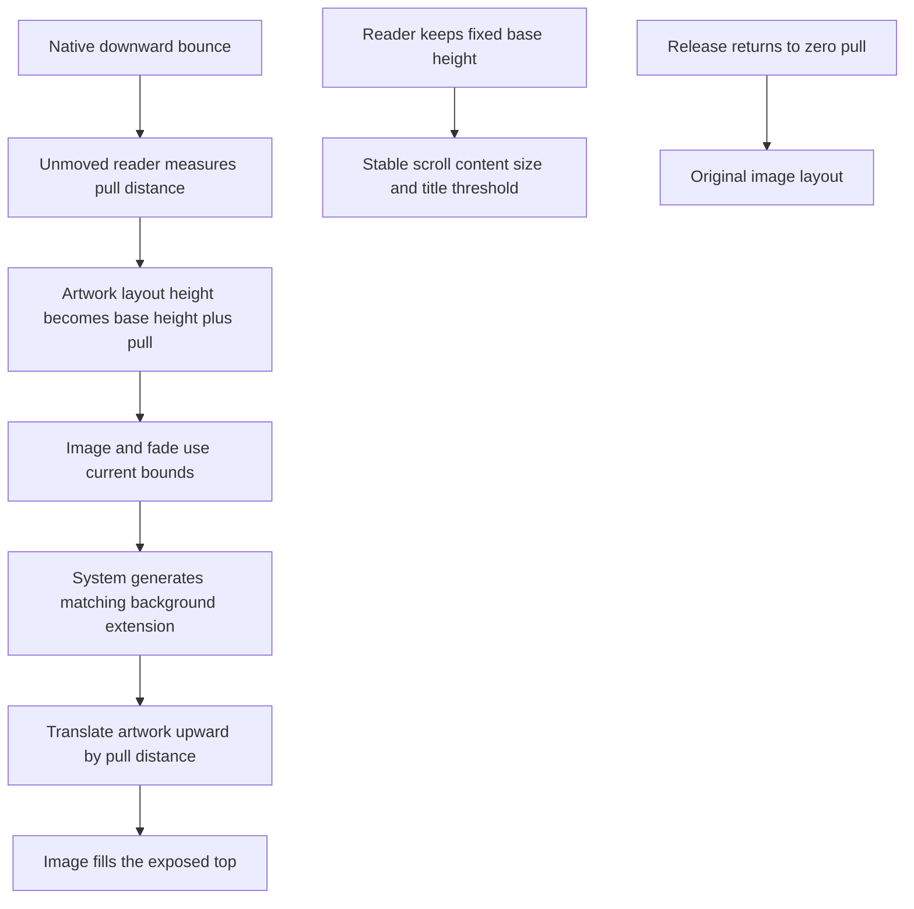
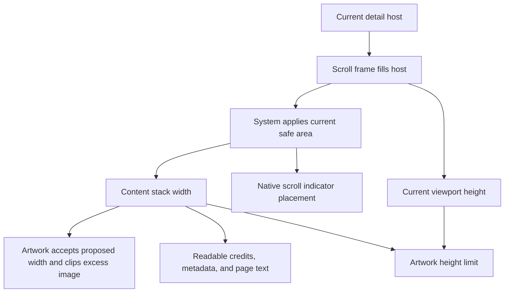
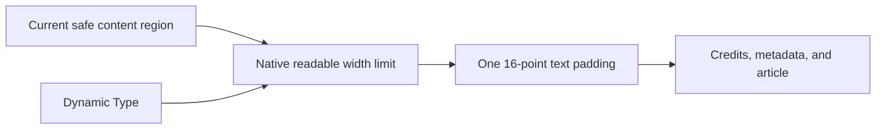

# Festival iOS resizability

Scope: the festival iOS app and the first-party CityOS code that it links. The minimum iOS version is 17. The initial worktree was clean on `feature/city-events-redesign` at `9e26800acc95e40dd32c47c84811ba7705b69739`.

## Configuration results

- Launch storyboard is declared.
- All four iPad orientations are declared.
- Full screen is not required.
- Scene configuration and a scene delegate exist. Multiple app windows are disabled.
- Launch, orientation, and scene keys are unchanged. The app, widget, and embedded watch app now use the same project build number. This prevents an embedded-bundle version mismatch.

## Implemented changes

The user approved all seven remaining proposals on 2 October 2026. Existing local city-app and shared-package changes are preserved.

| Surface | Result |
| --- | --- |
| Scene activation | `SceneDelegate.sceneDidBecomeActive` refreshes configuration and synchronizes authorized notification topics. All four obsolete AppDelegate callbacks are removed. App setup stays in AppDelegate. |
| Readable text width | A mounted UIKit controller measures the current SwiftUI container's readable guide. Container size, local traits, safe area, and SwiftUI Dynamic Type update the measurement. Only the latest valid width is delivered after layout. The public modifier stays the same. |
| Programme and saved programme | Every device uses the adaptive split controller. Column-style collapse/expand callbacks move the existing detail stack between primary and secondary navigation controllers. Nested venue pushes use the active content column. Search keeps its modal navigation path. |
| Map drawer | Local horizontal size class selects a sheet or overlay panel. Transfers reuse the drawer, collection view, search text, venue navigation stack, and map. The saved sheet detent survives a round trip. A transition gate uses the latest size class, tab selection, and queued venue selection. UIKit owns the sheet container in the map's presentation context. Forced update requests use the latest publisher value and finish Map suspension before presentation. |
| Countdown | Retained label constraints change their margins with the local horizontal size class: 16 points in compact width and 0 in regular width. |
| Venue detail | Normal venue screens read their live SwiftUI horizontal size class. A map overlay explicitly requests the existing card layout through a retained observable layout state. Transfer back to a sheet restores automatic layout. The model, hosting controller, and expansion state stay in place. |
| Legacy event detail | UIKit supplies automatic scroll insets. Explicit bottom spacing is 16 points. A content-origin correction retains the image behind the bar and the no-image safe-top spacer. Text uses the visible viewport's separate horizontal safe areas. The legacy stretch offset is relative to the adjusted top inset. |

## File queue

All detected festival targets are implemented or explicitly excluded below. Additional helper and test files are listed with their callers.

- [x] `ios/moers festival/moers festival/ApplicationController.swift`: local size class for browser presentation.
- [x] `ios/moers festival/moers festival/Controller/TabBarController.swift`: local browser presentation and coordinated Map suspension/resumption. Finish suspension before selecting the latest requested tab. Coalesce pending forced update requests. Keep the local iPad system-tab mode policy.
- [x] `ios/moers festival/moers festival/Coordinator/OtherCoordinator.swift`: adaptive Info & Tickets columns and local web navigation.
- [x] `ios/moers festival/moers festival/Extensions/Extensions.swift`: replace legacy layout guides. Checks for versions below the supported deployment target were removed in the later availability cleanup.
- [x] `ios/CityOS/Sources/Core/Extensions/ViewController+Extensions.swift`: replace legacy layout guides. Checks for versions below the supported deployment target were removed in the later availability cleanup.
- [x] `ios/moers festival/moers festival/Venues/Controllers/NewMapViewController.swift`: dynamic containment, retained state, local safe area, and serialized presentation.
- [x] `ios/moers festival/moers festival/Venues/Controllers/MapPanelContainerController.swift`: child transfer, panel safe areas, and reactive border display scale.
- [x] `ios/moers festival/moers festival/Venues/Controllers/MapPanelState.swift`: separate panel-state type.
- [x] `ios/moers festival/moers festival/Venues/Controllers/MapPanelPassthroughView.swift`: separate panel hit-test type.
- [x] `ios/moers festival/moers festival/Venues/Drawer/TabSheetPresentationController.swift`: supported local-context presentation; UIKit owns container layout.
- [x] `ios/moers festival/moers festival/Venues/Drawer/TabSheetTransitioningDelegate.swift`: restore the saved detent.
- [x] The shared city map uses persistent UIKit sheets and a split view for wide windows. The custom drawer framework and its rendering workarounds were removed.
- [x] `ios/moers festival/moers festival/Venues/Drawer/NewMapDrawerViewController.swift`: remove cached tab-bar inset; retain search and collection state and notify after appearance.
- [x] `ios/moers festival/moers festival/User Schedule/UserScheduleViewController.swift`: both horizontal safe-area edges.
- [x] `ios/CityOS/Sources/Events/UI/View/EventDetailView.swift`: local width/height header invalidation, automatic insets, header origin, and separate horizontal safe areas.
- [x] `ios/CityOS/Sources/Core/UI/ReadableContentWidth.swift`: preserve the public modifier and use the mounted measurement bridge.
- [x] `ios/CityOS/Sources/Core/UI/ReadableContentWidthMeasurement.swift`: local SwiftUI container and Dynamic Type bridge.
- [x] `ios/CityOS/Sources/Core/UI/ReadableContentWidthMeasurementController.swift`: local guide measurement, trait invalidation, coalesced reporting, and removal cleanup.
- [x] `ios/moers festival/moers festival/Controller/AdaptiveTabSplitViewController.swift`: current column-style callbacks and retained detail stacks.
- [x] `ios/moers festival/moers festival/Coordinator/EventCoordinator.swift`: adaptive split on every device.
- [x] `ios/moers festival/moers festival/User Schedule/UserScheduleCoordinator.swift`: adaptive split on every device.
- [x] `ios/moers festival/moers festival/Coordinator/SharedCoordinator.swift`: active content navigation and automatic venue context; capture modal presenter before storing the new modal.
- [x] `ios/moers festival/moers festival/Coordinator/MapCoordinator.swift`: automatic venue context.
- [x] `ios/moers festival/moers festival/Controller/Live/CountdownViewController.swift`: dynamic label margins.
- [x] `ios/moers festival/moers festival/Venues/Venue/VenueDetailController.swift`: retained layout state, clear host background, close and presentation-completion callbacks.
- [x] `ios/moers festival/moers festival/Venues/Venue/VenueDetailScreen.swift`: live size class and preserved expansion state.
- [x] `ios/moers festival/moers festival/Venues/Venue/VenueDetailPresentationContext.swift`: separate context type; local size class in the compatibility helper.
- [x] `ios/moers festival/moers festival/Venues/Venue/VenueDetailLayoutState.swift`: observable containment intent without replacing the SwiftUI root.
- [x] `ios/moers festival/moers festival/AppDelegate.swift`: remove the four obsolete lifecycle callbacks together.
- [x] `ios/moers festival/moers festival/SceneDelegate.swift`: run both activation calls in the owning scene callback.

The focused validation files are `FestivalResizabilityTests.swift`, `AdaptiveTabSplitResizabilityTests.swift`, `MapDrawerResizabilityTests.swift`, and `ForcedUpdateResizabilityTests.swift` in the festival test target, plus `CoreTests/ReadableContentWidthTests.swift` and `EventsTests/ViewModel/EventDetailLayoutTests.swift` in CityOS. The latter two files contained local work before this implementation; their checks are extended or adapted to the approved behavior.

## Explicit exclusions

- Camera orientation mask: preserve the permitted orientations. A mask is not a direct replacement for orientation locking.
- Global review-scene helper and app-level activation/timer observers: outside the skill's AppDelegate migration. Record their impact in PAPERCUTS.
- Full-bleed map, media, gradients and backgrounds: keep their edge constraints.
- Map panel width already subtracts left and right insets separately and updates during layout.
- Watch, tvOS, Android and external package code: outside this iOS app check.

## Info & Tickets split layout

Follow-up scope on 3 October 2026: use the existing adaptive split for Info & Tickets. The list stays in the primary column. The selected web page or native screen uses the secondary column. Narrow width moves the same detail stack into the primary navigation controller. The column proposal retains the whole stack; the completion callback installs it after UIKit changes columns. A temporary root display during this transfer is not treated as Back. Nested web links update the pending stack during a column change, or use their source controller's current navigation controller afterward. The selected row stays marked only in wide windows. An overview route or compact Back clears the detail and its row selection.

The Info list retains its first visible row and that row's position in the visible area before the column change or overview departure. It restores this position after the stack transfer and overview layout. Intermediate column changes cannot replace the saved position. A user drag or scroll-to-top releases it. Automatic safe-area insets and the readable-content list layout stay in use. Long Info row titles can wrap in the narrow primary column.

Follow-up on 25 October 2026: the shared split controller uses UIKit's automatic primary-column sizing. The 340-point minimum, 420-point maximum, and 32% width request are removed. This also applies to Programme and Favorites. The tiled list/detail presentation and navigation-state transfer remain in use. UIKit can select column widths for the current window and fold without an app-defined width limit.

Validation on Duo with iOS 27.2: the fifteen existing split, Info coordinator, and license layout checks passed. The new sizing check passed in a separate run. It compares the rendered primary-column width with a plain UIKit split in the same window at 951-by-669, 1194-by-834, and 669-by-951 points. The comparison uses regular traits and checks width policy; it does not prove adaptation to an actual fold.

The updated app also passed a device check in the 466-by-678-point outer-display window: Info shows one usable column, and About opens with readable content and a native back control. The Open → Partially Folded → Closed → Open check remains blocked because Device Hub's fold controls time out.

Sidebar selection in an expanded split now replaces the secondary column through `setViewController(_:for:)`, then shows that column. This follows [Apple's column-style split view guidance](https://developer.apple.com/documentation/uikit/uisplitviewcontroller/setviewcontroller%28_%3Afor%3A%29). Each selected topic or event starts with a new navigation controller containing only that content. The previous animated navigation-stack reset could look like a push between unrelated sidebar items. Nested links still push within the selected content's navigation controller, and compact selection keeps normal list-to-detail navigation.

The navigation follow-up passes all seventeen focused split, Info coordinator, and license layout checks on Duo with iOS 27.2. The added sidebar check verifies that selection replaces the secondary navigation controller, removes the previous column, starts with one content controller, and does not start a navigation push transition. Existing checks retain nested links, compact Back, selection, and scroll position across column changes.

The primary column uses `.systemBackground`, matching the main content and following the current light or dark appearance. Its `primaryBackgroundStyle` is `.none` so the sidebar effect does not change that background. The Info list also sets its native list configuration's `backgroundColor` to `.systemBackground`; setting only the collection view or navigation view background leaves the grouped-list background visible.

The wide iPad check passed at 1210-by-834 points on iOS 27.2: About → Licenses → About replaces the main content, keeps the sidebar visible, and adds no Back path through previous topics. The final background build also passed visual checks in light and dark appearance: both column surfaces match white or black, while native row cards keep their system appearance. The simulator's original light appearance was restored.

Follow-up file queue:

- [x] `Coordinator/OtherCoordinator.swift`: adaptive root, web and native detail routes, overview reset, and isolated wide/narrow previews.
- [x] `Controller/AdaptiveTabSplitViewController.swift`: retained column transfer, pending nested links, selected detail identity, and column-start/detail-change callbacks.
- [x] `Controller/Other/OtherViewController.swift`: retain the detail's wide row selection and restore the visible list position until the user scrolls again.
- [x] `ApplicationController.swift`: reset both Info columns for overview routes.
- [x] `Controller/TabBarController.swift`: use the concrete Info web route.
- [x] `Assets/Localizable.xcstrings`: English/German empty-detail prompt.
- [x] `moers festival Tests/OtherCoordinatorResizabilityTests.swift`: routes, nested links, resize, and selection checks.
- [x] `moers festival Tests/AdaptiveTabSplitResizabilityTests.swift`: temporary primary-root restoration with the same nested detail stack.
- [x] `ViewModels/Main Views/Other/OtherDataSource.swift`: allow Info row titles to wrap.
- [x] `ios/CityOS/Sources/AppScaffold/UI/SettingsRowContentConfiguration.swift`: opt-in title line count, with the current one-line default.

`OtherView` already sizes its list from the local readable-content area. It needs no layout change. Staff bulletins and external review/developer actions are outside this column-routing change.

Fourteen focused tests pass on iPhone 16e with iOS 18.6: ten Info tests and four adaptive split tests. They cover all nine web topics, four native destinations, nested web Back, controller identity across repeated size changes, row restoration, compact Back, immediate overview reset, and application/tab web routes. Added regression checks cover UIKit's temporary primary-root restoration, pending web links and topic/reset requests, window geometry changes inside the tab controller, list-position restoration after hidden and intermediate layouts, and later user scrolling/scroll-to-top. The source review passes. The English/German string catalog is valid JSON. The stack-transfer state supplies row marking because UIKit can report the previous `isCollapsed` value in the collapse callback.

After the title-wrapping change, the three list/selection/window tests passed again. Focused SwiftLint completed with no errors; its sixteen warnings are in existing source. The final source and test files contain no temporary trace code.

The final build installed and ran on Duo with iOS 27.1. Native About passed an immediate 951-by-669 → 466-by-678 → 951-by-669-point fold round trip. The app process, About screen, Info tab, selected row, and list position remained the same. The 340-point primary column showed Awareness and Accessibility on two lines. Before and after the fold, Volunteers stayed at y=74.7 points. Later user scrolls moved the list. The public Festival Village page loaded in the secondary column and stayed visible across the fold. Compact Back returned to the Info overview; opening then showed the empty detail prompt with no selected topic.

Two device checks remain incomplete. A later overview returned to the top after snapshot/session operations and native window reselection, while About and Info remained selected. The cause is unverified. The comparison without snapshot sessions could not start because two guarded Device Hub recovery attempts selected other device windows. No input was sent to those devices. Live nested web Back also remains unverified: the hierarchy tap had no effect and the native-coordinate fallback failed with `windowNotFoundAtPosition`. The focused tests cover nested web Back. The original Programme/Map/rotation smoke checks did not start during this follow-up.

## Event row selection

Programme and Favorites derive the active event ID from the event detail in the shared split controller. The row remains selected while the detail column is visible. Compact navigation clears the row mark; expanding restores it from the retained detail. Returning to the overview clears selection. Nested detail navigation keeps the parent event selected.

The shared day-page cell uses native collection-view selection and list backgrounds for compact and image rows. It resolves the event ID in the current diffable snapshot after refresh, filtering, or page reuse. A filtered or removed event has no selected row, and its mark returns if the event reappears while its detail is still open. Selection does not scroll the list or change the selected day. The programme preview list uses native SwiftUI list selection; the venue grid marks the same event and exposes its selected accessibility trait.

Twenty focused checks pass on Duo with iOS 27.2: six event-selection checks, six split-navigation checks, and eight Favorites day-navigation checks. The selection fixtures use an in-memory database. They cover detail replacement, compact Back, expansion, refreshed row identities, filtering, favorite removal and reinsertion, image rows, native preview-list selection, and selection updates without scrolling or navigation callbacks.

The iPad device check also passed on iOS 27.2 at 1210-by-834 points. In Programme and Favorites, selecting a second event moves the native row highlight and accessibility `Selected` state to the event shown in the content column. The two temporary favorites used for this check were removed, restoring the original empty Favorites state. The display preference was unchanged.

## Programme date strip follow-up (4 October 2026)

Scope: correct the wrapped `22` in the 340-point programme column. The same shared selector serves compact, image, and venue-grid modes. Each circle uses the same size, day text stays on one line, and the row scrolls when its content cannot fit. Selection stays in the caller's timetable model.

File queue:

- [x] `ios/CityOS/Sources/Events/Events/Overview/DayItem.swift`: equal circles, single-line date text, and Dynamic Type.
- [x] `ios/CityOS/Sources/Events/Events/Overview/DaySelector.swift`: equal cells, fitting row or horizontal scroll, selected-date visibility, and isolated previews.
- [x] `ios/CityOS/Tests/EventsTests/ViewModel/DaySelectorLayoutTests.swift`: focused width, text-size, and scroll regression checks.
- [x] `PAPERCUTS.md`: record the result for the reported date-strip issue.
- [x] This report: record source, test, and device evidence.

Five focused `DaySelectorLayoutTests` pass on iPhone 16e with iOS 18.6. They check two-digit day height under width compression, English/German row height at 308/340/420 points, scrolling across 200/160/600/200-point widths, a selected date with a different time component, accessibility text sizes 3 and 5, a date added before the same selected day, changed selection, and header space above the compact event pages. Source review passes. Focused SwiftLint reports no warnings or errors.

The current festival build installed and launched on Duo iOS 27.1, PID 31620. Its 951-by-669-point window has a 340-point programme column. Native UI shows five equal circles and aligned single-line day numbers and weekday captions. Tapping `22` marks Friday as selected and changes Thursday's Workshop/WDR rows to Friday's moersify/Clemens Köhler/Workshops rows. The 466-by-678-point Closed/Open round trip retains Friday, the selected Schedule tab, Friday's event rows, and PID 31620. All five day numbers and captions stay aligned on one line in both sizes. Larger text is covered by the hosted tests; no simulator text-size preference was changed.

Native screenshot reviewed: `/private/tmp/festival-date-strip-20261004.png`, copied from `/Users/lennart/Desktop/Screenshot iPhone Duo 04.10.2026 at 00.39.27.png`. Closed screenshot: `/Users/lennart/Desktop/Screenshot iPhone Duo 04.10.2026 at 00.36.08.png`.

AX before/after: `/var/folders/c3/nhvb43vd6458kcrgjf45v56w0000gn/T/ActionArtifacts/default/DeviceInteractionSynthesize/Festival Programme Friday Before Fold-00_34_18_161-hierarchy.txt` and `Festival Programme Friday After Fold-00_38_50_584-hierarchy.txt` in the same directory. All standalone interaction sessions closed; workspace aliases had expired. Xcode screenshots were black, so native screenshots supplied the visual check.

The workspace device session expired during InstallAndRun on two bounded attempts. Xcode reported a successful current build each time. The exact build product was installed and launched through simulator tooling. No app data was reset.

Test result: `/var/folders/c3/nhvb43vd6458kcrgjf45v56w0000gn/T/ActionArtifacts/default/RunSomeTests/D8196AA9-6976-4160-B105-ABBCA8298B6F.txt`.

## Validation

- The implemented festival app built, installed, and launched on iPhone Duo with iOS 27.1. The current UI hierarchy confirms a 951-by-669-point window, a 340-point programme primary column, cached events, and the detail placeholder.
- The initial audit verified a 466-by-678 to 951-by-669-point fold change. The active timetable filter remained set. The filter controls, five day buttons, empty-state text, and all five tabs remained visible without overlap. This earlier visual check does not prove the later navigation and Map changes.
- Eighteen focused tests pass across iOS 18.6 and iOS 27.2. The eight initial festival layout and adaptive-navigation tests passed on iPhone 18 Pro with iOS 27.2. The five festival layout tests and four shared-package tests passed on iPhone 16e with iOS 18.6.
- The final seven-test run passed on iPhone 16e with iOS 18.6. It covers Map drawer and venue transfer, a queued second venue selection, immediate tab return, forced-update replacement and cancellation during a queued tab change, and the legacy stretchy header with automatic insets.
- Shared tests cover mounted readable-guide measurement, Dynamic Type, coalesced width updates, and event text with unequal horizontal safe areas. Navigation tests retain selected and nested controllers, scroll position, pre-appearance selection, and search navigation.
- Focused SwiftLint checks pass. Remaining warnings are in existing source. No new helper or test warning remains.
- Source review found no missing safe replacement. `git diff --check` passes.
- DeviceInteraction screenshots retained the pre-fold display geometry after opening the device. Native DeviceHub UI supplied the window-size evidence; the stale captures are a validation-tool limit.
- On 2 October, the final fold, visible state retention, Map, browser, and rotation checks were blocked by the locked Mac. CUA could not unlock it. The session had expired when cleanup was attempted. Automated tests cover these state transfers. The 3 October Info & Tickets follow-up has a separate device check; it does not complete the earlier Map and rotation checks.

## Excluded linked files

These files were detected in linked products. Festival source does not instantiate these city-only controllers, so this festival check does not change them. Their separate local edits are preserved:

- `ios/CityOS/Sources/AppScaffold/Split/SplitViewController.swift`: City no longer instantiates this shared split controller. Festival uses its own adaptive split controller.
- `ios/CityOS/Sources/MapFeature/Controller/CameraViewController.swift`: preserve the orientation mask. The festival map does not use this camera controller.
- The unused shared `ContentDrawerView` was removed with the drawer framework.
- `ios/CityOS/Sources/MapFeature/View/SearchDrawerViewController.swift`
- `ios/CityOS/Sources/MapFeature/Controller/MapContainerViewController.swift`
- `ios/CityOS/Sources/MapFeature/Controller/SelectionViewController.swift`
- `ios/CityOS/Sources/MapFeature/Controller/Detail/DetailViewController.swift`
- `ios/CityOS/Sources/MapFeature/SeachController/LFSearchViewController.swift`
- `ios/CityOS/Sources/MapFeature/Entry Onboarding/EntryOnboardingAddressViewController.swift`
- `ios/CityOS/Sources/MapFeature/Entry Onboarding/EntryOnboardingGeneralViewController.swift`
- `ios/CityOS/Sources/MapFeature/Entry Onboarding/EntryOnboardingOpeningHoursViewController.swift`
- `ios/CityOS/Sources/MapFeature/Entry Onboarding/EntryOnboardingOverviewViewController.swift`

The initial audit found manual scroll, bar-height, and keyboard-inset handling in MapFeature. Separate local work now changes these city-only files. This festival implementation preserves that work.

`ios/CityOS/Sources/Core/UI/PageView/PageView.swift` has only a commented idiom expression. It has no executable effect. Local idiom use for the festival's UIKit tab-bar mode is an explicit system policy; keep it.

## Event image margins — 5 October 2026

The modern event screen applied `readableContentWidth()` to the whole scroll stack. This also gave the header image the readable guide's side margins on phones. The modifier now applies only to credits, their divider, event metadata, and native page content. The image uses the current container width. Its aspect ratio, clipping, and 520-point height limit remain in use. Text width still updates when the local container, traits, safe area, or Dynamic Type changes.

Files: `Controller/Events/ModernEventView.swift` and this report. The festival build and all five selected `FestivalResizabilityTests` pass on iPhone 18 Pro with iOS 27.2. Focused SwiftLint and the source diff check pass. These tests cover the existing UIKit resize and safe-area behavior. The updated app also built, installed, and ran through the device tools. The modern event detail screenshot and hierarchy show a 402-point phone window and a header at x = 0 with width = 402 points. The metadata row stays at x = 16 with width = 370 points; its complete title wraps within x = 32 and width = 338 points. This proves portrait edge alignment. Wide-window image alignment was not separately captured.

## Immersive event artwork — 25 October 2026

The Duo baseline showed a 382-point image in a 466-point window. The image stopped at the trailing safe area, leaving an 84-point white strip behind the system controls.

The festival detail keeps its SwiftUI scroll view and native UIKit navigation bar. `EventDetailHeroView` applies `backgroundExtensionEffect()` to the artwork on iOS 26 or later. The system mirrors and blurs the image outside the safe area. Credits, metadata, page text, and controls remain separate from the effect. Earlier systems show the same artwork and bottom fade without the extension effect. The fade uses the system background color for light and dark appearance.

On iOS 26 or later, when artwork is present, the scroll view ignores only the top container safe area so the image starts behind the top bars, as in Apple's TV example. It keeps the horizontal safe areas for text and controls. Geometry observation measures the local viewport size without a surrounding layout wrapper or a second safe-area subtraction. Events without artwork and older systems retain the top safe area. The older app theme uses a solid navigation-bar background, so placing artwork under that bar would hide its top edge.

The image height follows its aspect ratio, with limits of 520 points and 65 percent of the current viewport height. A height-only resize therefore leaves space for the event content. The artwork is aligned to the top to preserve poster headings. The top scroll-edge effect uses `.soft` on iOS 26 or later. While the image remains in the scroll viewport, the native navigation title is hidden. Once the image has scrolled out, the existing `UINavigationItem` shows the event title. Returning to the image hides that title again. Back and Favorite stay available throughout. On iOS 27 or later, the event navigation item sets its minimization behavior to `.never`, so continuing to scroll down does not minimize the title bar. Events without artwork keep the native title. Only a Boolean header-visibility change updates state; the navigation bar is not manually hidden or moved.

This follows Apple's [SwiftUI example](https://developer.apple.com/videos/play/wwdc2025/323/) and the [UIKit guidance](https://developer.apple.com/videos/play/wwdc2025/284/). A separate `UIBackgroundExtensionView` or a UIKit rewrite is not needed for this screen. The extension effect supplies background content; it does not pin a header.

The festival build and nine focused tests pass on Duo with iOS 27.2. Four presentation checks cover title reveal after the artwork, continued downward and upward scrolling, return to the artwork, missing artwork and event updates, height-only resizing, and a scroll view that fills its host with asymmetric safe areas. The scroll fixture loads a long article through an in-memory page repository so its offsets stay within the real content range. Five lifetime checks cover observation after navigation and controller, coordinator, and view-model release. Focused SwiftLint has no new warnings or errors.

The iOS 18.6 test runner did not start. That run was stopped and does not supply older-runtime execution evidence.

The original image-edge layout was checked on iOS 27.2 at 1210 by 834 points on iPad and 466 by 678 points on Duo. Artwork reached the top and trailing screen edges; text stayed clear of controls. The current soft-effect build was installed and launched on Duo. Its top state was checked through native DeviceHub controls: no event title covers the image, and Back and Favorite remain available. The live body-scroll check is incomplete. Xcode interaction sessions expired immediately, and native DeviceHub scroll/drag input failed or did not move the content. The scene-based tests cover the title transitions in both directions. No favorites, app settings, or fold posture were changed.

## Stretchy artwork

`EventDetailHeroView` uses layout resizing for pull-to-stretch, following the mechanism in Apple's [Landmarks sample](https://developer.apple.com/documentation/swiftui/landmarks-building-an-app-with-liquid-glass). The artwork receives its current expanded height before the system generates the mirrored background extension. The native scroll view keeps its bounce and scrolling behavior. Event pages with artwork enable vertical bounce even when the page is shorter than the viewport. Pages without artwork keep the automatic bounce policy.

For a pull distance `d` and normal image height `h`, the image receives height `h + d` and moves upward by `d` inside a fixed-height `GeometryReader`. The reader measures its own unmoved frame in the scroll coordinate space. Its child cannot change that measurement or the reported header height. This gives the same size compensation as the sample's negative bottom padding without per-frame offset state. Credits and body text follow native scroll movement; the content size and title threshold stay fixed.

The image accepts the current width and height proposal, clips its aspect-fill content, and adds the fade within those bounds. On iOS 26 or later, `backgroundExtensionEffect()` generates the extension from this resized artwork. Earlier systems use the same image layout without that effect. The fixed-height reader stays unclipped so the enlarged image can fill the exposed top. Only translation is applied after background extension; there is no scale transform on the generated extension.

The previous implementation used a uniform `visualEffect` scale after background extension. A similar [standalone stretchy-header example](https://nilcoalescing.com/blog/StretchyHeaderInSwiftUI/) works on an image alone. It does not combine that transform with the extension's separate mirrored, blurred, and clipped regions. Apple [documents this clipping](https://developer.apple.com/documentation/swiftui/view/backgroundextensioneffect()). Resizing the source layout keeps these regions on the same current bounds and avoids scaling the completed extension.

The header retains an offline interactive preview. Rendered tests hold 30-, 120-, and 240-point pulls with both leading and trailing side insets. They check image zoom through a red marker, fill across the top and side regions, color continuity across the full uniform image row, unchanged scroll content size, and restoration after release. Scanning the full row also catches a seam displaced from the original safe-area boundary. Extension checks apply on iOS 26 or later; earlier systems check the source image. Screenshots are retained for each state.

The festival build and all six focused event-detail tests pass on Duo with iOS 27.2. A second focused run of the full-row seam check also passes. The title-transition, height-only resize, and horizontal overflow checks remain in place. Focused SwiftLint and the source diff check pass.

The final native check confirms normal scrolling, Closed → Open resizing, and the 16-point text margin. A live open-display pull remains unverified: both the native drag and device-touch retry left the artwork unchanged. Their recordings are labelled `no-pull` and do not supply seam evidence. The held rendered pull states supply the extension-boundary checks; they do not replace live animation acceptance. This input limit remains recorded in `PAPERCUTS.md`.

## Event scroll width during resizing — 25 October 2026

The event artwork could keep its previous width when the detail column became narrower. Its aspect-fill image then made the scroll view wider than its host. In the scene-based regression check, a 326.2-point host contained a 354.3-point scroll view. This also moved the native scroll indicator and changed text placement. The event screen sets no manual scroll-indicator insets.

`ModernEventView` now measures the content stack's width inside the scroll view. It measures only viewport height outside the scroll view. `EventDetailHeroView` accepts the proposed width with a flexible frame whose minimum width is zero, before applying its height and clipping. The image can therefore crop to a smaller width without making the parent wider. The image aspect ratio and viewport height limit still control its height. Background extension and pull-to-stretch remain on the artwork.

The scroll view fills its host. SwiftUI and UIKit apply the current safe area to content and indicators. There are no copied safe-area values, manual indicator offsets, or device-specific widths. Credits, metadata, and page content keep their readable-width layout within the current content proposal. A system side inset can still place a scroll indicator inside the window edge; the app must not cancel that inset.

`EventDetailContentLayoutTests` uses a real window scene and a local image and article. It changes the host width from wide to narrow and back, switches the leading and trailing insets without changing the width, and returns to the first layout. It checks the scroll frame, content width, horizontal offset, and automatic indicator adjustment, and retains screenshots and native scroll geometry. `EventDetailPresentationTests` continues to check title transitions, viewport height changes, full-host scrolling, and rendered pull-to-stretch behavior.

The festival build and six focused tests pass on Duo with iOS 27.2. The layout test, including the full-host frame assertions, also passes on iPad Air 11-inch (M4) with iOS 27.2. Retained screenshots show readable metadata and article text with either side inset. The narrow Duo fixture now has a 326.3-point scroll frame in a 326.2-point host, within pixel rounding, and a 236.3-point content width that matches its safe area. The iPad fixture keeps a 574-point scroll frame and 484-point content width when the trailing inset is 90 points. Focused SwiftLint and the source diff check pass.

The live Duo check opens an event and scrolls its body. At 466 by 678 points, the scroll frame fills the host, the text clears the trailing controls, and the native indicator is at x = 460 with width = 3 points. Opening Duo keeps the same event in a 951-by-669-point split view. The 321-point schedule column leaves a 630-point detail host; metadata and body text stay clear of the divider and system controls.

The live divider-drag check remains unverified because DeviceHub returned `noWindowsAvailable`; its accessibility value update did not move the divider. This tool limit is recorded in `PAPERCUTS.md`. The automated scene tests cover changing content widths and side insets. The live check restored the original closed portrait posture and changed no app settings or favorites.

## Event text margins — 25 October 2026

Event credits, metadata, and article blocks already supply 16 points of horizontal padding. The readable-width measurement also applied UIKit's minimum layout margins. The combined margin was 32 points in compact layouts and 36 points in the checked wide split view.

These three sections now use `readableContentWidth(includeLayoutMargins: false)`. Its invisible measurement view has zero base margins and does not enforce system minimum margins for this option. The existing content padding supplies the single 16-point text margin inside the safe content region. UIKit's readable guide still limits line width in large windows and follows Dynamic Type. The default option remains enabled for other callers. The shared page blocks keep their existing padding.

The festival build and all four `ReadableContentWidthTests` pass on iPad Air 11-inch (M4) with iOS 27.2. The tests cover default behavior, one content padding inside asymmetric safe areas, option changes, and comparison with the native readable guide at small and accessibility text sizes. The live Duo check confirms title and article x = 16 in the closed layout and x = 337 for a detail column that starts at x = 321 in the open layout. Each has one 16-point leading margin. Focused SwiftLint and the source diff check pass.
